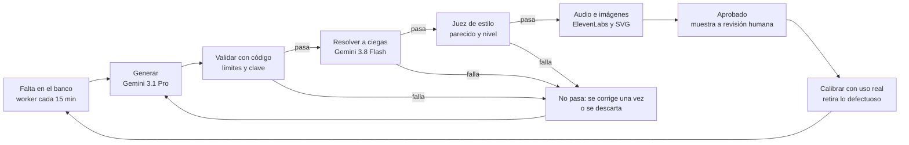
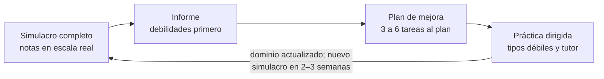

# Plan: preparación IELTS Academic y exámenes de alemán en MyPAL

Actualizado: 12 de octubre de 2026 · Autor: Edwin Ortiz Herazo · Repositorio: [chronosedwin8/mypal_english_german](https://github.com/chronosedwin8/mypal_english_german)

## Resumen y decisiones por confirmar

MyPAL suma un módulo **Exámenes** en el que cada persona elige a qué examen prepararse: **IELTS Academic** (perfiles EN\_US y EN\_GB) o, en **alemán** (perfil DE), **Goethe-Zertifikat B1, B2 o C1** o **TestDaF**. Todos usan un mismo motor: banco de preguntas generado por IA y revisado, audios de escucha con ElevenLabs, modos de práctica, simulador completo con tiempos reales, nota en la escala oficial, plan de estudios adaptativo y retroalimentación por simulacro. Además se vende a **empresas, colegios y universidades**, con un panel para que los docentes sigan a sus estudiantes.

Principios que guían todo el plan:

- **Fiel al examen real:** mismas secciones, tipos de pregunta, cantidad de ítems, tiempos y reglas (cuántas veces suena un audio, qué se puede revisar). Nunca se copia contenido de exámenes oficiales.
- **Banco generado por adelantado:** el worker genera, valida y sintetiza preguntas antes de que alguien las pida, y las reutiliza entre usuarios sin repetirlas a la misma persona. Así el costo por usuario es casi cero y la calidad se puede revisar.
- **Lo que cuesta por usuario va en cuotas:** calificar Writing y Speaking con IA y el examinador con avatar se cuentan por plan, y `pnpm check:pricing` los suma al peor caso para mantener el margen mínimo del 60 %.
- **Nota honesta:** se muestra en la escala oficial como estimación, con un aviso de que no es un resultado oficial.

| Decisión | Propuesta | Alternativa |
| --- | --- | --- |
| Exámenes disponibles | Decidido: la persona elige IELTS Academic, Goethe B1, B2 o C1, o TestDaF | — |
| IA para generar y calificar | Decidido: API de Google (Gemini), con salida JSON validada por esquema | Otro proveedor detrás de la misma interfaz (necesario para menores, ver Instituciones) |
| Speaking del simulador | Examinador por voz (ElevenLabs + Scribe), incluido en el plan | Examinador con avatar Tavus, que gasta minutos del plan |
| Pronunciación | Azure Pronunciation Assessment | Solo métricas de Scribe (menos precisa) |
| Acceso individual | Cuotas en los 3 planes actuales + un plan nuevo "Solo exámenes" | Solo los planes actuales |
| Instituciones | Licencias por estudiante, grupos y panel de seguimiento docente | Solo venta individual |
| Menores en colegios | Decidido: estudiantes de 15 a 17 años en cuentas institucionales, con el permiso que ya tiene el colegio y bajo supervisión docente; también usan el tutor avatar | — |
| Audio del banco | Decidido: Amazon S3 con URLs prefirmadas | Archivos en `public/` como hoy (no sirve para audios generados en producción) |

## Qué existe hoy y qué se reutiliza

El repositorio (commit `33a0d35`) ya tiene casi toda la base: Next.js 16, Prisma 7 + PostgreSQL, Better Auth, Zod, un worker con candado único, ElevenLabs (texto a voz y Scribe v2) y un catálogo de precios con prueba de margen. Faltan dos piezas: **no hay ningún modelo de lenguaje (LLM)** integrado y **los audios se sirven desde `public/`**, generados una sola vez con un script.

| Pieza existente | Dónde está | Uso en Exámenes |
| --- | --- | --- |
| Cliente ElevenLabs (TTS + Scribe v2) | `src/server/speech/elevenlabs.ts` | Se amplía con diálogos de varias voces y marcas de tiempo; Scribe transcribe el Speaking |
| Voces por variante | `src/lib/voices.ts` | Se amplía con voces de examen (varios acentos) |
| Script de audios offline | `scripts/generate-audio.ts` | Patrón para el trabajo del worker que sintetiza el banco |
| Motor adaptativo IRT y nivel MCER | `src/server/diagnostic/irt.ts` | Base para estimar el dominio por tipo de pregunta y elegir ítems |
| Métricas de habla | `src/server/diagnostic/speaking-score.ts` | Fluidez y variedad léxica como insumo del calificador de Speaking |
| Configuración editable | `src/server/config/index.ts` | Claves nuevas `exam.*`: cuotas, interruptor, presupuesto diario de IA |
| Catálogo y margen | `src/lib/pricing/catalog.ts`, `margin.ts` | Derechos de examen por plan y su costo dentro del peor caso |
| Clases con Tavus | `src/server/sessions/lifecycle.ts` | Speaking con examinador avatar (opcional, gasta minutos) |
| Vocabulario con repaso espaciado | modelo `VocabularyItem` | Palabras de las lecturas y errores de Writing entran al repaso |
| Worker | `worker/index.ts` | Bucles nuevos: reabastecer el banco, calificar, recalcular planes |
| Panel admin | `src/app/admin/` | Revisión de preguntas, calidad del banco, gasto de IA |
| Navegación de la app | `src/components/app/app-nav.tsx` | Nueva pestaña "Exámenes" |

## Especificación de los exámenes

Cada examen se describe en código, igual que el catálogo de precios: un archivo por examen en `src/content/exams/` con secciones, partes, tipos de pregunta, número de ítems, tiempos, reproducciones de audio y tablas de nota. Un test unitario falla si una forma generada no cumple esa especificación.

### Exámenes que la persona puede elegir

La persona elige a qué examen se prepara entre cinco opciones, y puede preparar más de uno a la vez (por ejemplo, IELTS y Goethe B2), cada uno con su propio plan, progreso y simulacros.

| Examen | Para qué se suele pedir | Nivel que mide | Resultado |
| --- | --- | --- | --- |
| IELTS Academic | Admisión a universidades y trámites profesionales en países de habla inglesa | Todos los niveles | Bandas de 0 a 9 |
| Goethe-Zertifikat B1 | Trabajo, formación profesional y trámites que piden B1 | B1 | 0–100 por módulo, aprobado con 60 |
| Goethe-Zertifikat B2 | Estudios y trabajo calificado que piden B2 | B2 | 0–100 por módulo, aprobado con 60 |
| Goethe-Zertifikat C1 | Estudios universitarios donde se acepta C1 | C1 | 0–100 por módulo, aprobado con 60 |
| TestDaF | Admisión a universidades alemanas | B2 a C1 | TDN 3, 4 o 5 por sección |

- **Ayuda para elegir:** tres preguntas (para qué lo necesita, país o institución, nivel del test de nivel actual) sugieren un examen y un nivel Goethe. La persona decide, y la app le recuerda confirmar el requisito con su institución.
- **Varios exámenes:** cada examen tiene su plan activo; el cupo de simulacros y correcciones del producto se comparte entre ellos.
- **Cambiar de examen o de nivel** (por ejemplo, de Goethe B1 a B2) no borra el historial: el dominio por habilidad sirve de punto de partida del nuevo plan.
- **Disponibilidad:** cada examen se activa o desactiva desde el admin y, para las instituciones, en su configuración.
- **Variante de inglés:** el examen IELTS usa acentos variados para todos; el perfil EN\_US o EN\_GB solo cambia la ortografía sugerida en Writing.

### IELTS Academic (versión en computador)

Desde mediados de 2026 IELTS se presenta solo en computador (en algunos mercados el Writing puede hacerse a mano); las secciones y lo que se evalúa no cambian. El simulador replica la versión en computador.

| Sección | Tiempo real | Estructura | Tipos de pregunta | Regla del simulador |
| --- | --- | --- | --- | --- |
| Listening | 30–34 min, incluidos 2 min finales para revisar | 4 grabaciones, 40 preguntas: diálogo cotidiano, monólogo cotidiano, conversación académica de hasta 4 personas, conferencia | Opción múltiple, emparejar, rotular plano/mapa/diagrama, completar formulario/notas/tabla/flujo/resumen, completar oraciones | Cada audio suena una sola vez; tiempo de lectura antes y revisión después de cada parte |
| Reading | 60 min | 3 textos académicos largos, 40 preguntas | Completar huecos, emparejar encabezados, completar oraciones, respuesta corta, opción múltiple, True/False/Not Given, Yes/No/Not Given | Sin tiempo extra; resaltado y notas en pantalla |
| Writing | 60 min | Tarea 1 (≥ 150 palabras, \~20 min): describir un gráfico, tabla, diagrama o proceso. Tarea 2 (≥ 250 palabras, \~40 min): ensayo argumentativo | — | Contador de palabras; la persona reparte el tiempo |
| Speaking | 11–14 min | Parte 1: temas personales. Parte 2: tarjeta, 1 min para preparar y 1–2 min hablando sin interrupción, más 1–2 preguntas. Parte 3: discusión abstracta sobre el tema | Fluidez y coherencia, léxico, gramática, pronunciación | Grabado; puede hacerse el mismo día u otro |

**Escala IELTS:** cada sección va de 0 a 9 en medias bandas. La banda general es el promedio de las cuatro, redondeado a la media banda más cercana: un promedio terminado en ,25 sube a ,5 y uno terminado en ,75 sube al entero (6,25 → 6,5; 6,125 → 6,0; 3,875 → 4,0). Listening y Reading convierten aciertos sobre 40 a banda; IELTS publica referencias aproximadas (banda 5 ≈ 16 en Listening y 15 en Reading; 6 ≈ 23; 7 ≈ 30; 8 ≈ 35) y advierte que el corte varía un poco entre versiones. Writing y Speaking promedian cuatro criterios con igual peso; en Writing la Tarea 2 pesa más que la Tarea 1 ([IELTS: puntuación en detalle](https://ielts.org/take-a-test/your-results/ielts-scoring-in-detail)).

### Alemán: Goethe-Zertifikat B1, B2 y C1

Cada nivel es un examen distinto con 4 módulos que se aprueban por separado con 60 de 100 puntos. Lesen y Hören tienen 30 ítems de 1 punto que se convierten a 100 (en B1, aciertos × 3,33 redondeado: 25 → 83). El Sprechen es normalmente en pareja, con compañero asignado al azar y dos examinadores.

| Nivel | Lesen | Hören | Schreiben | Sprechen |
| --- | --- | --- | --- | --- |
| B1 | 5 partes, 30 ítems, 65 min | 4 partes, 30 ítems, \~40 min | 3 partes, 60 min | 3 partes, \~15 min en pareja, 15 min de preparación |
| B2 | 5 partes, 30 ítems, 65 min | 4 partes, 30 ítems, \~40 min | 2 partes, 75 min | 2 partes, \~15 min en pareja, 15 min de preparación |
| C1 | 4 partes, 30 ítems, 65 min | 4 partes, 30 ítems, \~40 min | 2 partes, 75 min | 2 partes, \~20 min en pareja, 20 min de preparación |

**Escala Goethe:** 90–100 sehr gut, 80–89 gut, 70–79 befriedigend, 60–69 ausreichend, 0–59 nicht bestanden. Los módulos escritos suman unos 165 min (B1) o 180 min (B2 y C1), con pausas de al menos 15 min entre ellos.

**Detalle por parte, ejemplo B2** (según el Modellsatz oficial; B1 y C1 se especifican igual con sus propios modelos antes de generar contenido):

| Módulo | Parte | Texto | Ítems y formato | Audio / tiempo |
| --- | --- | --- | --- | --- |
| Hören | 1 | 5 diálogos o mensajes breves | 10: richtig/falsch y a/b/c alternados | Suena 1 vez |
| Hören | 2 | Entrevista de radio | 6: a/b/c | Suena 2 veces |
| Hören | 3 | Conversación de varias personas | 6: ¿quién lo dice? | Suena 1 vez |
| Hören | 4 | Charla breve | 8: a/b/c | Suena 2 veces; luego 5 min para pasar respuestas |
| Lesen | 1–5 | Foro, artículo, artículo, opiniones, reglamento | 9 + 6 + 6 + 6 + 3: emparejar, insertar frases, a/b/c, emparejar | 18 + 12 + 12 + 12 + 6 min sugeridos |
| Schreiben | 1 | Aporte a un foro con opinión | \~150 palabras | \~50 min |
| Schreiben | 2 | Mensaje formal | \~100 palabras | \~25 min |
| Sprechen | 1 | Presentación sobre un tema elegido, y preguntas del compañero | \~4 min por persona | — |
| Sprechen | 2 | Discusión con el compañero sobre un tema polémico | \~5 min | — |

Como el Sprechen es en pareja, el simulador agrega un **compañero virtual** con voz de IA que presenta, pregunta y discute como otro candidato.

### TestDaF (versión digital)

El TestDaF es un solo examen para B2–C1, en computador, con cuatro secciones; cada una da TDN 3, 4 o 5. El simulador replica la versión digital.

| Sección | Tareas | Formatos | Tiempo | Regla del simulador |
| --- | --- | --- | --- | --- |
| Lesen | 7 | Completar huecos, ordenar frases, opción múltiple, clasificar afirmaciones, emparejar actos de habla y pares de conceptos, hallar errores en un resumen | \~55 min | — |
| Hören | 7 | Respuestas cortas, errores en un resumen, emparejar personas y afirmaciones, opción múltiple, relacionar sonido y escritura; las tareas 4 y 5 son con video | \~40 min | Cada tarea suena una vez. El video se aproxima con audio de ElevenLabs y diapositivas dibujadas desde datos |
| Schreiben | 2 | Ensayo argumentativo (≥ 200 palabras, 30 min) y resumen de un texto y un gráfico (\~100–150 palabras, 30 min) | \~60 min | Contador de palabras y reloj por tarea |
| Sprechen | 7 | Respuestas grabadas frente al computador, de 0:45 a 2:30 min por tarea; la primera es de calentamiento | \~35 min | Sin examinador en vivo, así que es el Speaking más fácil de reproducir con fidelidad |

**Escala TestDaF:** puntos brutos de Lesen 34, Hören 30, Schreiben 10 (dos tareas de 0 a 5) y Sprechen 30. Cada sección se lleva a una escala de 0 a 20 (total de 0 a 80) y de ahí a TDN 3, 4 o 5, que equivalen a B2.1 hasta C1.2. La fuente no da los cortes entre puntaje y TDN; el simulador usará cortes estimados, marcados como tales, hasta validarlos con resultados reales.

Esta descripción viene de un artículo técnico de 2022 del instituto que administra el TestDaF ([Kecker y Eckes, 2022](https://www.gast.de/fileadmin/gast.de/GAST/4_PDF/2-Forschung-Entwicklung/Publikationen/Kecker_Eckes_2022_Info_DaF_49_4_289-324.pdf)); antes de generar contenido se contrasta con el modelo de examen vigente.

Fuentes: [IELTS (British Council): formato](https://takeielts.britishcouncil.org/take-ielts/test-format) · [IELTS en computador (IDP)](https://ielts.idp.com/about/ielts-on-computer) · [IELTS: cambios de entrega](https://ielts.org/news-and-insights/updates-to-ielts-test-delivery) · [Goethe B1: reglamento](https://goethe.de/pro/relaunch/prf/no/Durchfuehrungsbestimmungen_B1.pdf) · [Goethe B2: reglamento](https://www.goethe.de/pro/relaunch/prf/vi/Durchfuehrungsbestimmungen_B2.pdf) · [Goethe B2: Modellsatz](https://www.goethe.de/pro/relaunch/prf/materialien/B2/b2_modellsatz_erwachsene.pdf) · [Goethe C1: reglamento](https://www.goethe.de/pro/relaunch/prf/sr/Durchfuehrungsbestimmungen_C1_neu.pdf) · [TestDaF (Goethe Singapur)](https://www.goethe.de/ins/sg/de/m/kur/prf/testdaf/inf.html)

## Generación de preguntas con IA y audios con ElevenLabs

Las preguntas se generan con la API de Google (Gemini) y se guardan en un **banco revisado**; no se generan en el momento del examen. El worker mantiene un inventario mínimo por examen, sección, tipo de pregunta y dificultad, y lo repone cuando baja. La unidad del banco es el **bloque**: un texto o una grabación con sus preguntas, como en el examen real (por ejemplo, un texto de Reading con 13 preguntas de tres tipos).



Lo que falla en la validación, el resolutor o el juez se corrige una vez o se descarta; lo aprobado se calibra con uso real, y lo que se retira deja un hueco que el worker repone.

1. **Elegir qué falta.** El worker detecta el hueco del inventario (por ejemplo, "IELTS Listening parte 2, rotular mapa, banda 6–7") y elige un tema que no se haya usado hace poco.
2. **Generar.** Gemini 3.1 Pro escribe el texto o guion y las preguntas como JSON con un esquema por tipo de pregunta, que luego valida Zod. Cada tipo tiene una guía de estilo versionada: extensión, registro, cómo se construyen los distractores y en qué orden aparecen las respuestas.
3. **Validar con código.** Extensión de los textos, límites como "NO MORE THAN TWO WORDS", que cada respuesta de completar esté literal en el texto o guion, opciones sin duplicados y vocabulario acorde al nivel.
4. **Resolver a ciegas.** Otro modelo (Gemini 3.8 Flash), sin ver la clave, responde el bloque como un candidato. Si no coincide con la clave o justifica dos respuestas, el bloque se corrige o se descarta. Esto atrapa los True/False/Not Given ambiguos, el error más común de las preguntas generadas.
5. **Juez de estilo y nivel.** Un tercer paso puntúa el parecido con el examen real, el nivel, los sesgos culturales y el contenido sensible. Debajo del umbral, se descarta.
6. **Audio (Listening y Hören).** El guion trae hablantes, acotaciones y la voz del narrador con sus pausas reales de lectura. ElevenLabs Text to Dialogue (modelos Eleven v4 o v3) lo sintetiza con varias voces; acepta hasta 2.000 caracteres por solicitud, así que se sintetiza por tramos y se une. IELTS usa acentos variados; el alemán, voces nativas. Después, Scribe transcribe el audio y se compara con el guion para detectar palabras mal pronunciadas o perdidas.
7. **Imágenes.** Mapas y planos de Listening y gráficos de Writing Tarea 1: la IA entrega datos (series, puntos, nodos) y el código los dibuja en SVG. Así nunca aparece un número o rótulo equivocado dentro de una imagen.
8. **Aprobar.** Lo que pasa todos los controles queda aprobado; una muestra configurable va a revisión humana en `/admin/examenes`.
9. **Calibrar con uso real.** Con 30 o más respuestas por pregunta se calculan su dificultad y discriminación reales; las defectuosas se retiran y la dificultad del bloque ajusta la tabla de nota de cada forma.

**Generación al momento**, solo en práctica dirigida ("10 preguntas de True/False/Not Given de banda 6,5") y solo si el banco no tiene suficientes bloques no vistos por esa persona, con un tope diario.

**Sin repeticiones:** una tabla de exposición garantiza que nadie vea el mismo bloque en dos simulacros. En práctica sí se pueden repetir, a propósito, las preguntas falladas.

**Costo de producir contenido:** un Listening completo de IELTS son unos 20.000–25.000 caracteres de audio, unos $1,60–2,00 a $0,08 por cada 1.000 caracteres. Con textos, preguntas y validaciones, una forma completa cuesta unos $3, que se reparten entre todos los usuarios que la usan. La generación del banco usa la Batch API de Gemini, con 50 % de descuento.

Fuentes: [ElevenLabs Text to Dialogue](https://elevenlabs.io/docs/capabilities/text-to-dialogue) · [Precios de la API de ElevenLabs](https://elevenlabs.io/pricing/api) · [Precios de la API de Gemini](https://ai.google.dev/gemini-api/docs/pricing) · [Salida estructurada en Gemini](https://ai.google.dev/gemini-api/docs/structured-output)

## Modos de práctica y simulador

Hay seis modos de práctica que van de lo puntual a lo completo, y un simulador que reproduce el examen real con sus tiempos. Todos usan el mismo banco y el mismo formato de pantalla, así la persona se acostumbra a la interfaz del examen desde el primer día.

| Modo | Qué hace | Tiempo | Retroalimentación |
| --- | --- | --- | --- |
| Práctica por tipo de pregunta | 5–15 preguntas de un solo tipo (True/False/Not Given, rotular mapa, Lesen Teil 2…) | Libre o cronometrado por pregunta | Inmediata: respuesta correcta, explicación en español y la frase del texto o audio que la justifica |
| Práctica por parte | Una parte completa (Listening parte 3, Lesen Teil 4…) | El tiempo real de esa parte | Al terminar la parte |
| Sección cronometrada | Una sección entera en condiciones reales (Reading 60 min, Hören \~40 min) | Real | Nota de la sección en su escala |
| Escritura guiada | Una tarea de Writing o Schreiben | Opcional | Nota por criterio, errores marcados, versión corregida, ejemplo de nivel superior y opción de reenviar |
| Speaking por partes | Una parte con el examinador de voz (y el compañero virtual en Goethe) | Real | Transcripción, nota por criterio y frases para mejorar |
| Repaso de errores | Preguntas falladas y palabras nuevas, con repaso espaciado | Libre | Inmediata |
| **Simulacro completo** | El examen entero con reglas reales | Real, sin pausas | Informe completo (ver "Calificación") |

### Reglas del simulador

- **Reloj en el servidor.** Cada sección guarda su hora de inicio y su hora límite; el reloj del navegador solo muestra. Al vencer, el servidor cierra la sección y califica lo respondido; las respuestas que llegan tarde se rechazan.
- **Orden fijo.** IELTS: Listening → Reading → Writing seguidos, y Speaking el mismo día o agendado después, como en el examen. Goethe: módulos escritos con pausas de 15 min y Sprechen con su tiempo de preparación (15 o 20 min). No se puede volver a una sección cerrada.
- **Audio como en el examen.** En IELTS cada grabación suena una sola vez; en Goethe, el número de veces que fija cada parte (en B2: 1, 2, 1 y 2). Sin pausa, sin adelantar y con el tiempo de lectura narrado antes de cada parte. El audio llega por una URL firmada que vence en minutos.
- **Pantalla tipo IELTS en computador.** Texto y preguntas lado a lado, resaltado y notas, navegador de preguntas con marca para revisar, contador de palabras en Writing y sin corrector ortográfico.
- **Concentración.** Pantalla completa y aviso si la persona cambia de pestaña; el cambio queda registrado en el informe.
- **Cupo.** El simulacro descuenta del cupo del plan al empezar el Listening. Si falla algo de nuestro lado (audio, servidor), el cupo se devuelve.

### Speaking simulado

- **Examinador por voz (incluido).** Turnos: la pregunta suena con ElevenLabs, la persona responde grabando, Scribe transcribe y Gemini 3.8 Flash decide la siguiente pregunta siguiendo el guion del examinador (neutral, sin dar retroalimentación durante la prueba). Las preguntas de las Partes 1 y 2 se generan con anticipación y sus audios quedan en el banco; solo los seguimientos de la Parte 3 se sintetizan al momento, con un modelo rápido de ElevenLabs. Meta: menos de 2,5 s entre la respuesta y la siguiente pregunta.
- **Parte 2 de IELTS:** tarjeta en pantalla, 1 min de preparación con espacio para notas y corte automático a los 2 min de habla.
- **Goethe en pareja:** un compañero virtual del nivel objetivo presenta, hace preguntas tras la presentación de la persona y discute con ella; un examinador virtual modera.
- **Examinador con avatar (opcional).** El mismo guion con un tutor Tavus configurado como examinador. Reutiliza el ciclo de clases existente y descuenta minutos del plan.

**Entrega de resultados:** Listening, Reading, Lesen y Hören se califican al instante. Writing y Speaking se califican en el worker en pocos minutos y la persona recibe un aviso cuando el informe está listo.

## Calificación y resultados en la escala real

Cada simulacro termina con la nota en la escala oficial de su examen: bandas de 0 a 9 en IELTS y puntos de 0 a 100 con su calificación en Goethe. Los números los calcula el código; la IA solo califica lo abierto (Writing, Speaking) y redacta las explicaciones.

| Sección | Cómo se califica | Resultado que ve la persona |
| --- | --- | --- |
| IELTS Listening y Reading | Automática. Las respuestas abiertas se normalizan (mayúsculas, ortografía británica o americana, números en cifras o letras); una palabra mal escrita o un exceso del límite de palabras cuentan como error, como en el examen | Aciertos sobre 40 y banda |
| Goethe Lesen y Hören | Automática; aciertos sobre 30 convertidos a 100 con la tabla oficial | Puntos, calificación y aprobado/no aprobado |
| IELTS Writing | Gemini 3.1 Pro con los descriptores públicos de banda y ensayos ancla calificados por un examinador certificado. Dos calificaciones independientes; si difieren en más de una banda en algún criterio, una tercera decide | Banda por criterio, banda por tarea y banda de Writing |
| IELTS Speaking | Transcripción con marcas de tiempo (ritmo, pausas, autocorrecciones) + evaluación de pronunciación + Gemini para fluidez, léxico y gramática (Gemini también puede escuchar el audio, lo que se prueba en el spike como alternativa a Azure) | Banda por criterio y banda de Speaking |
| Goethe Schreiben y Sprechen | Igual que IELTS, con los criterios publicados en el Modellsatz de cada nivel y dos "examinadores" virtuales | Puntos, calificación y aprobado/no aprobado |

**TestDaF:** Lesen y Hören se califican solos; Schreiben (0 a 5 por tarea) y Sprechen (seis tareas grabadas) con IA y doble calificación. El resultado es la escala de 0 a 20 y el TDN de cada sección.

**Tabla de conversión de IELTS por forma.** La tabla base sale de las referencias oficiales (banda 6 ≈ 23/40, 7 ≈ 30/40, 8 ≈ 35/40) con cortes intermedios interpolados. Cuando la forma acumula respuestas suficientes, su dificultad calibrada mueve los cortes, igual que en IELTS cambian un poco entre versiones. Mientras tanto, el informe dice "forma en calibración".

**Peso de las tareas de Writing.** IELTS dice que la Tarea 2 pesa más, pero no publica la fórmula. Se usará (Tarea 1 + 2 × Tarea 2) / 3 redondeado a media banda, como supuesto configurable y documentado.

**Informe del simulacro:**

- **IELTS:** una tarjeta con Listening, Reading, Writing, Speaking y banda general (con la regla oficial de redondeo), la banda objetivo y la diferencia con ella, y su equivalencia MCER. Inspirada en el informe oficial, sin copiar su diseño ni sus marcas.
- **Goethe:** puntos y calificación por módulo, aprobado o no por módulo, y si los cuatro están aprobados, el equivalente al certificado completo.
- **Margen de error:** cada nota muestra un rango (por ejemplo, 6,5 ± 0,5) calculado con el error de medición del motor IRT.
- **Tiempo:** minutos usados por sección y parte, preguntas sin responder al cierre y si la Parte 2 de Speaking se quedó corta.

**Honestidad y mejora continua:** cada resultado dice "nota estimada, no oficial". Quien presente el examen real puede registrar su nota oficial; comparar ambas permite medir el error del simulador y ajustar las tablas y las instrucciones de calificación.

## Plan de estudios, seguimiento y plan de mejora

Cada persona que prepara un examen tiene un plan semanal que se recalcula solo: después de cada práctica y de cada simulacro cambia lo que sabe el sistema sobre ella, y el plan se ajusta a eso. El cálculo del plan es código determinista; la IA solo redacta las explicaciones.



El plan de mejora es el paso que convierte el informe en tareas: sin él, el simulacro solo mide; con él, cambia lo que la persona estudia las semanas siguientes.

### Inicio

1. **Elegir el examen y la meta:** IELTS Academic con banda objetivo (por ejemplo 6,5, o mínimos por sección si su universidad los pide), Goethe con nivel y puntaje objetivo, o TestDaF con el TDN objetivo por sección. El nivel Goethe se sugiere a partir del test de nivel que ya existe.
2. **Disponibilidad:** fecha del examen (opcional), horas por semana y días disponibles.
3. **Punto de partida:** una prueba de entrada de unos 60 minutos (una parte de cada sección) o, si la persona prefiere, un primer simulacro completo. De ahí sale el dominio inicial por sección, tipo de pregunta y criterio.

### Cómo se arma el plan

- Las horas se reparten según la brecha entre la nota actual y la meta en cada sección, y dentro de cada sección según los tipos de pregunta más débiles.
- Se programan simulacros cada 2–3 semanas y uno final 5–7 días antes del examen, sin pasar del cupo del plan.
- Cada semana mezcla práctica por tipo, partes completas, una sección cronometrada, Writing con reescritura, Speaking por partes y 10 minutos diarios de repaso de vocabulario.
- Si el plan incluye minutos con el tutor, se agregan clases de Speaking: el tutor recibe en su contexto las debilidades de la persona (por ejemplo, "practica la Parte 3 y pide ejemplos concretos").
- Si la fecha no alcanza para la meta, el plan lo dice con la proyección de nota y propone otra fecha u otra meta.

### Después de cada simulacro

- **Fortalezas:** secciones, tipos de pregunta y criterios que ya están en la meta o por encima.
- **Debilidades:** lo que está por debajo, ordenado por cuánto subiría la nota general si mejora. Ejemplo: "subir True/False/Not Given de 50 % a 75 % suma unos 3 aciertos en Reading, media banda".
- **Plan de mejora:** de 3 a 6 tareas concretas ("8 sesiones de 15 min de True/False/Not Given", "3 tareas de Writing 1 con diagramas de proceso y reescritura", "5 tarjetas de Parte 2 cronometradas"). Entran al plan de estudios con su origen (el simulacro) y la persona puede aceptarlas o moverlas.
- **Recalcular:** el worker reorganiza las semanas que faltan con el nuevo dominio.

### Seguimiento

La página de progreso muestra:

- nota estimada por sección y general a lo largo del tiempo, con la línea de la meta;
- mapa de dominio por tipo de pregunta y por criterio de Writing y Speaking;
- historial de simulacros con su informe;
- horas estudiadas frente a las planeadas y racha;
- tiempo por pregunta y preguntas sin responder, para ver si el problema es de tiempo o de conocimiento.

Las palabras nuevas de las lecturas y los errores de vocabulario del Writing entran a "Mi vocabulario", con el repaso espaciado que ya existe.

## Acceso según plan, costos y margen

Los tres planes actuales casi no tienen holgura: con la fórmula del repo, el peor caso deja a Básico a 30 centavos del 60 %, a Fluido a 46 y a Inmersión a 70. Un solo simulacro con Writing y Speaking calificados por IA los dejaría por debajo. Por eso lo que cuesta por uso va en productos nuevos, y los planes actuales reciben lo que cuesta casi cero.

### Costo variable estimado por unidad

| Unidad | Qué incluye | Costo estimado | Supuesto para el margen |
| --- | --- | --- | --- |
| Práctica autocalificada (Listening, Reading, Lesen, Hören) | Bloques del banco ya generados; audio servido desde almacenamiento | ≈ $0 | $0 |
| Corrección de una tarea de Writing | Dos calificaciones con Gemini 3.1 Pro, rúbrica en caché, informe y reescritura | ≈ $0,10 | $0,15 |
| Una parte de Speaking | Scribe, voz del examinador, turnos con Gemini 3.8 Flash, calificación con Gemini 3.1 Pro | ≈ $0,10 | $0,15 |
| Simulacro completo | Writing con sus dos tareas (≈ $0,20) + Speaking completo (≈ $0,27) + pronunciación (precio por confirmar) + parte del costo del banco | ≈ $0,60–0,70 | $1,00 |
| Speaking con avatar | Minutos de Tavus | 14 min ≈ $5,20 | Se paga con minutos del plan, ya protegidos |

Los costos salen de los precios publicados ($0,08 por 1.000 caracteres de voz, $0,22 por hora de Scribe, Gemini 3.1 Pro a $2/$12 y Gemini 3.8 Flash a $0,75/$3,75 por millón de tokens de entrada/salida, vigentes hasta el 31 de diciembre de 2026; desde 2027 Flash sube a $1,50/$7,50. El razonamiento interno de Gemini se cobra como salida, y por eso los supuestos del margen llevan holgura). Se confirman midiendo en la fase de calibración, y el panel admin muestra el costo real por unidad.

### Propuesta de productos (USD/mes)

| Producto | Precio | Simulacros completos | Correcciones de Writing | Partes de Speaking | Margen mínimo |
| --- | --- | --- | --- | --- | --- |
| Planes actuales (Básico, Fluido, Inmersión) | Sin cambio | — | — | — | Sin cambio |
| Pase de examen (complemento de un plan actual) | $15 | 2 | 6 | 8 | 64,7 % |
| Plan Examen (sin avatar) | $19 | 2 | 8 | 10 | 65,1 % |
| Plan Examen Intensivo (sin avatar) | $35 | 4 | 16 | 20 | 64,9 % |

Todos incluyen sin límite la práctica autocalificada, el plan de estudios y el seguimiento. Los planes actuales también reciben esa parte gratis, porque su costo es casi cero y empuja a comprar el pase. El margen se calcula con la fórmula del repo al 100 % de uso: comisión de 6 % + $0,30, plataforma $0,50 en los planes (no en el complemento) y los supuestos de la tabla anterior.

Las licencias para empresas, colegios y universidades están en la sección "Instituciones".

### Cómo se hace cumplir

- `catalog.ts` suma un bloque `exam` a cada producto y `margin.ts` agrega el costo variable de examen al peor caso. `pnpm check:pricing` y los tests fallan si algo queda por debajo del 60 %.
- Los cupos viven en la base de datos como contadores por periodo, con CHECK que impide usar más de lo otorgado. Se reservan al empezar y se devuelven si falla algo de nuestro lado, igual que los minutos.
- Configuración nueva en el admin: interruptor de exámenes, presupuesto diario de IA y tope diario de generación al momento por usuario.
- La producción del banco es un costo fijo, como la mensualidad de Tavus. El banco inicial (unas 20 formas de IELTS y 10 por nivel Goethe, a unos $3 cada una) cuesta del orden de $150–200 una sola vez, y el panel muestra el gasto mensual de reposición.
- **Embudo gratis:** una práctica gratuita (un texto de Reading o una parte de Listening) para quien no ha pagado, con costo casi cero, igual que el test de nivel.

## Instituciones: empresas, colegios y universidades

Una institución compra licencias para sus estudiantes o empleados, los organiza en grupos a cargo de un docente, y el docente sigue su avance, asigna práctica y simulacros y ve estadísticas del grupo y de cada persona. Usa el mismo motor de exámenes; lo nuevo es la organización, los roles, las asignaciones y el panel docente.

### Roles

| Rol | Quién es | Qué puede hacer |
| --- | --- | --- |
| Administrador de la institución | Coordinación académica o Recursos Humanos | Comprar y repartir licencias, crear grupos, invitar docentes, elegir qué exámenes están disponibles, ver todos los grupos, exportar reportes y gestionar la facturación |
| Docente | Profesor o formador | Crear y administrar sus grupos, agregar estudiantes, asignar práctica y simulacros, ver avance y resultados, revisar y ajustar notas de Writing y Speaking, comentar y exportar |
| Estudiante | Alumno o empleado | Todo lo de un usuario individual, más sus tareas asignadas; ve qué datos suyos ve la institución |
| Administrador de MyPAL | Equipo interno | Ver y administrar usuarios, instituciones, accesos y costos, y usar la app como cualquier usuario (sección "Panel de administración de MyPAL") |

### Agregar estudiantes

- Invitación por correo, enlace o código de grupo, y carga masiva por CSV (nombre, correo, grupo y examen).
- Inicio de sesión con Google o Microsoft para las instituciones que usan esas cuentas.
- Cada estudiante activo ocupa una licencia. Al retirarlo, la licencia se libera y su cuenta sigue siendo suya, con su historial, pero la institución deja de verla.

### Asignaciones

- El docente asigna a un grupo o a personas: práctica (tipo de pregunta, parte o sección), tareas de Writing o Speaking, o un simulacro completo, con fecha de apertura y de cierre.
- **Simulacro institucional:** el mismo examen, la misma forma y la misma hora para todo el grupo, con reloj real. El banco reserva una forma que nadie del grupo haya visto, y así el grupo se puede comparar pregunta por pregunta.
- Las asignaciones entran al plan de estudios de cada estudiante como tareas con fecha.

### Panel de seguimiento docente

```text
┌────────────────────────────────────────────────────────────────────────────┐
│ Grupo · examen · fecha objetivo                              [  Asignar  ] │
├──────────────────┬────────────────────────┬──────────────────┬─────────────┤
│ Activos en 7 días│ Nota estimada promedio │ Camino a la meta │ Asignaciones│
│                  │                        │                  │ al día      │
├──────────────────┴────────────────────────┴───┬──────────────┴─────────────┤
│ Estudiantes                                   │ Dónde falla el grupo       │
│ Estudiante        Nota  Meta  Simulacro Estado│ (una columna por estudiante│
│ ───────────────── ────  ────  ───────── ──────│  tono más fuerte = más     │
│ ...                ..    ..    ......     ●   │  errores)                  │
│ ...                ..    ..    ......     ●   │ True/False/NG    ▓ ▒ █ ░   │
│ ...                ..    ..    ......     ●   │ Rotular mapas    ░ ▒ ░ ▒   │
│ ● en meta   ● en riesgo   ● inactivo          │ Encabezados      ▒ ▓ ▒ █   │
│                                               │ Writing tarea 1  ▒ ░ ▓ ░   │
│                                               │ Speaking parte 3 ▓ ▒ ▒ ▓   │
├───────────────────────────────────────┬───────┴────────────────────────────┤
│ Asignaciones                          │ Revisiones pendientes              │
│ Simulacro institucional      [fecha]  │ Writing tarea 2        [ Revisar ] │
│ Práctica de True/False/NG    [fecha]  │ Speaking parte 2       [ Revisar ] │
└───────────────────────────────────────┴────────────────────────────────────┘
```

Boceto de la vista de un grupo: arriba los indicadores, a la izquierda los estudiantes con su semáforo, a la derecha los tipos de pregunta donde más falla el grupo (una columna por estudiante) y abajo lo que el docente tiene pendiente.

- **Resumen del grupo:** estudiantes activos en los últimos 7 días, nota estimada promedio y su distribución por sección, tendencia semanal, cuántos van camino a su meta y cumplimiento de las asignaciones.
- **Semáforo por estudiante:** en meta, en riesgo (la proyección queda debajo de la meta para su fecha) o inactivo (sin práctica en 7 días). Los umbrales se configuran por institución.
- **Mapa del grupo por tipo de pregunta y criterio:** dónde falla la mayoría, para decidir qué trabajar en clase.
- **Análisis de un simulacro asignado:** nota de cada estudiante, preguntas más falladas, distractores más elegidos y tiempo usado por sección.
- **Ficha del estudiante:** plan y cumplimiento, historial de simulacros con sus informes, ensayos y grabaciones, dominio por tipo de pregunta, horas de estudio y vocabulario.
- **Revisión humana:** el docente lee cada Writing y escucha cada Speaking, puede ajustar la nota de la IA con un motivo y deja comentarios. Su nota prevalece y además sirve para calibrar el calificador automático.
- **Comparaciones:** entre simulacros del mismo grupo y entre grupos.
- **Reportes:** exportación a CSV y PDF por grupo o por estudiante, resumen semanal por correo al docente y, para el administrador, un reporte de toda la institución (uso de licencias y avance por grupo).

### Estudiantes menores de edad

**Decidido:** las instituciones, sobre todo los colegios, pueden inscribir estudiantes de 15 a 17 años. Siempre cuentan con el permiso de sus padres, docentes y colegio, y usan la plataforma bajo la supervisión de un docente en el aula. Por eso el proceso es simple: la institución responde por las autorizaciones y MyPAL no pide aprobaciones extra por estudiante. El registro individual sigue siendo solo para mayores de 18.

**Requisitos legales y de proveedores**

- **Colombia:** los datos de menores solo se tratan si responden a su interés superior y con autorización previa, expresa e informada de su representante legal (Ley 1581 de 2012 y Decreto 1377 de 2013). El colegio ya la tiene (por ejemplo, en la matrícula) y lo declara una vez en el contrato con MyPAL; no hay trámite aparte por estudiante. Un abogado debe revisar esa cláusula.
- **Google (Gemini):** las condiciones de la API de Gemini exigen 18 años y prohíben usarla en servicios dirigidos a menores de 18 o que probablemente usen menores ([condiciones de la API de Gemini](https://ai.google.dev/gemini-api/terms)). Por eso, en las cuentas de menores, la IA en vivo (calificar Writing y Speaking, examinador y compañero virtual) va por otro proveedor detrás de la misma interfaz `AiProvider`: Vertex AI de Google Cloud si sus condiciones lo admiten, o si no Claude de Anthropic, que permite productos para menores con moderación, monitoreo y aviso de que se habla con una IA ([guía de Anthropic](https://support.claude.com/en/articles/9307344-responsible-use-of-anthropic-s-models-guidelines-for-organizations-serving-minors)). Para el colegio no cambia nada; también hay que confirmar si el banco generado con Gemini puede mostrarse a menores.
- **ElevenLabs y el servicio de pronunciación:** antes de activar el Speaking para menores hay que confirmar que sus términos permiten procesar voz de menores.

**Cómo funciona una cuenta de menor**

- **Alta:** el docente o el colegio crea o invita la cuenta con la fecha de nacimiento, y queda activa de inmediato. Se aceptan estudiantes desde los 15 años.
- **Al cumplir 18:** la cuenta pasa a adulta y el estudiante decide si sigue compartiendo sus datos con la institución.
- **Lo único que no tiene un menor:** compras y suscripciones propias, correos comerciales y unirse a otra institución por su cuenta.
- **Todo lo demás, igual que un adulto:** exámenes, simulacros, Speaking con el examinador por voz y tutor avatar (ver abajo).
- **Grabaciones:** se guardan el tiempo que defina la institución y solo las ven el estudiante y sus docentes.
- **Seguridad sin pasos extra:** instrucciones de seguridad para menores en los generadores, el examinador, el compañero virtual y el tutor; moderación automática de textos y transcripciones; aviso de que se habla con una IA. Nada de esto le pide trabajo al colegio.
- **Uso de los datos:** nunca para marketing ni para entrenar modelos (por eso la IA se usa siempre en niveles pagos que no usan los datos para entrenar); al terminar el contrato se exportan o se borran.
- **Textos legales:** `/legal/privacidad` y `/legal/terminos` suman una sección para menores e instituciones.

### Tutor avatar para menores

El tutor con avatar es el gancho comercial, y los estudiantes de 15 a 17 años lo usan en el aula con su docente presente. Por eso se activa de forma simple:

- **La institución lo activa una vez** y compra una bolsa de minutos, al precio de las recargas. Desde ese momento todos sus estudiantes pueden usarlo, menores incluidos.
- **El docente puede ajustarlo o apagarlo** para un grupo o un estudiante desde su panel (por ejemplo, limitar minutos o permitirlo solo en horario de clase), pero no tiene que aprobar a nadie.
- **La cámara** se permite o no para toda la institución con una sola opción.

**Protecciones en cada clase:**

- **Mismo tutor, reglas extra:** cuando el estudiante es menor, la clase lleva en su contexto de Tavus un bloque de instrucciones: temas de la lección, sin pedir datos personales y sin temas inapropiados. No hace falta crear tutores aparte.
- **Sin video grabado:** solo la transcripción, el resumen y las correcciones, que el docente puede revisar.
- **Alertas solo cuando hacen falta:** el tutor tiene una herramienta `flag_concern` y la transcripción pasa por moderación; si algo preocupa, el docente recibe un aviso.
- **Minutos con el mismo ledger:** la bolsa se reparte en partes iguales entre los estudiantes del grupo y el docente puede ajustarla; la reserva, el cobro al segundo y los topes de Tavus funcionan igual que hoy.

**Condición con Tavus antes de lanzar:** sus términos no prohíben usuarios finales menores, pero exigen consentimientos explícitos para datos biométricos (sección 6.2) y permiten a Tavus usar el contenido de los clientes para mejorar sus productos (sección 6.5). La autorización que ya recoge el colegio debe mencionar el video con un tutor de IA, y MyPAL necesita un acuerdo escrito con Tavus que excluya los datos de menores de ese uso. Es un trámite de MyPAL con Tavus, una sola vez, no del colegio. Su política de uso prohíbe cualquier contenido que dañe a menores ([términos](https://tavus.io/terms-of-service) · [política de uso](https://tavus.io/acceptable-use-policy)).

### Licencias para instituciones (USD por estudiante al mes)

| Licencia | Precio | Simulacros | Correcciones de Writing | Partes de Speaking | Margen mínimo |
| --- | --- | --- | --- | --- | --- |
| Estándar | $10 | 1 | 4 | 4 | 64,0 % |
| Intensiva | $18 | 2 | 8 | 10 | 63,4 % |

- Se cobran por semestre o por año, con un mínimo de licencias por definir. Las cuentas de docente no consumen licencia.
- Los cupos forman una **bolsa de la institución** (licencias × cupo): el docente puede dar más simulacros a quien está cerca del examen. El peor caso del margen es el mismo, porque el total no cambia.
- Minutos con el tutor avatar como bolsa opcional, con el precio de las recargas, que el docente reparte entre sus estudiantes, menores incluidos.
- Prueba institucional de 30 días con pocos estudiantes y práctica autocalificada, de costo casi cero.
- Los descuentos por volumen pasan por `pnpm check:pricing` como cualquier otro producto.
- En Colombia, empresas y colegios necesitan factura electrónica; hace falta un proveedor de facturación electrónica conectado a los pagos.

### Cómo se construye

- Rutas `/docente` (panel) e `/institucion` (administración), y API `/api/org/*`.
- Permisos en la capa de datos (`src/server/auth/dal.ts`): cada consulta filtra por institución y grupo, y un docente solo ve a los estudiantes de sus grupos.
- La ficha del estudiante consulta en vivo; los paneles de grupo leen resúmenes que el worker recalcula cada noche y al cerrar cada simulacro.

## Panel de administración de MyPAL

El administrador de MyPAL ve y controla toda la plataforma desde `/admin`, que hoy ya tiene métricas, clases en vivo, usuarios y configuración. Se amplía con instituciones, exámenes, accesos y moderación, y la cuenta de administrador puede usar todo como un usuario normal.

| Vista | Qué muestra | Qué se puede hacer |
| --- | --- | --- |
| Resumen | Usuarios activos, ingresos por producto (individual e institucional), costos por proveedor (Tavus, IA, voz, almacenamiento), margen real y de peor caso, simulacros hechos, estado del banco y alertas | — |
| Usuarios | Búsqueda y ficha: plan, cupos, minutos, exámenes, simulacros, instituciones y autorizaciones | Conceder o quitar accesos, cupos y minutos (con motivo), suspender, cambiar rol, reenviar verificación |
| Instituciones | Tipo, licencias usadas y compradas, docentes, grupos, estudiantes, menores, avatar para menores, minutos de la bolsa y facturación | Atender solicitudes de demo, crear, ajustar licencias, extender la prueba, suspender, ver como la institución (solo lectura) |
| Exámenes y banco | Inventario por examen, sección y tipo; revisiones pendientes; calidad; formas; precisión frente a notas oficiales | Aprobar, retirar, regenerar, pausar la generación |
| Clases en vivo | Lo que ya existe, con las clases de menores marcadas | Cerrar una clase |
| Accesos | Matriz de recursos por plan, licencia, institución y usuario | Activar o desactivar recursos y crear excepciones con fecha de vencimiento |
| Moderación y alertas | Preguntas reportadas, alertas de clases de menores y contenido marcado | Revisar, escalar y cerrar |
| Costos y presupuestos | Gasto diario por proveedor y por función | Ajustar topes y apagar funciones |
| Auditoría | Quién hizo qué y cuándo (`AuditLog` ya existe) | Filtrar y exportar |

### Control de accesos

- **Recursos definidos en código** (`src/lib/access/resources.ts`): cada examen, cada modo de práctica, simulacros, Writing y Speaking con IA, generación al momento, tutor avatar, avatar para menores, visión por cámara y panel docente.
- **Una sola función decide** (`can(usuario, recurso)`), en el servidor, en cada ruta y página. Busca en orden: excepción del usuario → grupo → institución → plan o licencia → valor global. La primera regla que aplica gana.
- **Las excepciones tienen motivo, autor y vencimiento**, y quedan en la auditoría. Ejemplo: dar a un estudiante acceso a Goethe C1 por 30 días.
- Los cupos (simulacros, correcciones, minutos) siguen en sus tablas con CHECK; el control de accesos dice si se puede usar un recurso, y el cupo cuánto.

### El administrador como usuario

- La cuenta de administrador tiene todos los recursos activos, sin muro de pago: puede elegir cualquier examen, practicar, presentar simulacros, hablar con el tutor avatar y crear una institución de demostración para probar el panel docente.
- **Su uso se registra como costo interno:** cuenta en los costos, no en los ingresos ni en el margen de los productos. Los minutos de avatar salen de un cubo de administrador que se renueva cada mes, así que el ledger y sus invariantes no cambian. Un tope diario configurable evita gastos por error.
- **Ver como:** para soporte, el administrador puede abrir la app como un usuario o una institución en modo solo lectura, y cada ingreso queda auditado. Grabaciones y transcripciones de menores no se abren por esta vía.
- **Seguridad:** segundo factor de autenticación obligatorio para administradores y un rol opcional de soporte, con lectura y acciones limitadas.

## Homepage: beneficios y oportunidades

Todas las novedades llegan a la landing (`src/app/(marketing)/page.tsx`): para quien estudia, como beneficios; para colegios, universidades y empresas, como oportunidades. Los precios se siguen leyendo de `catalog.ts`, y la lista de exámenes sale del control de accesos, así la página nunca anuncia algo que aún no está activo (lo que falta se muestra como "Próximamente").

| Sección | Mensaje | Llamado a la acción |
| --- | --- | --- |
| Hero (actualizado) | "Habla con tu tutor y prepárate para IELTS, Goethe o TestDaF"; junto a las banderas, un selector con los cinco exámenes | Haz una práctica gratis |
| Franja "Practica para" (actualizada) | Suma IELTS Academic, Goethe B1–C1 y TestDaF | — |
| Prepárate para tu examen (nueva) | Una tarjeta por examen: para qué sirve, qué nivel mide y su escala. Beneficio: mismo formato, mismos tiempos y misma escala que el examen real | Elige tu examen |
| Simulacros como el día del examen (nueva) | Reloj real, audio que suena una sola vez y nota en la escala oficial, con un informe de ejemplo | Mira un informe de ejemplo |
| Writing y Speaking con respuesta inmediata (nueva) | Examinador por voz, compañero virtual en Goethe y nota por criterio con correcciones | Prueba una tarea de Writing |
| Tu plan se ajusta solo (nueva) | El ciclo simulacro → informe → plan de mejora → práctica, y el progreso hacia la meta | Crea tu plan |
| Tu tutor ve tu mundo (existente) | Suma: practica con tu tutor el Speaking del examen | — |
| Para colegios, universidades y empresas (nueva) | Oportunidad: panel docente, grupos, simulacros institucionales, estadísticas por grupo y tutor avatar para estudiantes desde 15 años en el aula; licencias desde $10 por estudiante al mes | Solicita una demo |
| Precios (actualizada) | Suma Plan Examen, Examen Intensivo y Pase de examen a los planes actuales, y una línea para instituciones | Elegir plan · Hablar con ventas |
| Preguntas frecuentes (actualizada) | ¿La nota es oficial? (no, es estimada) · ¿Qué examen me conviene? · ¿Cómo funciona para colegios? · ¿Pueden usarlo menores? (solo a través de su institución) · ¿Están afiliados a IELTS o Goethe? (no) | — |
| Cierre (actualizado) | Dos caminos: estudiar por tu cuenta o llevarlo a tu institución | Empieza gratis · Para instituciones |

**Oportunidades fuera de la homepage:**

- Una página por examen (`/ielts-academic`, `/goethe-b1`, `/goethe-b2`, `/goethe-c1`, `/testdaf`) con su formato, su escala y una práctica gratis, para atraer búsquedas de cada examen.
- Una página `/instituciones` con el boceto del panel docente, los precios por licencia y el formulario de demo. Cada solicitud llega al panel de administración como una oportunidad comercial (modelo `InstitutionLead`: institución, tipo, contacto, número de estudiantes y exámenes de interés).
- **Mensajes honestos en todas:** "nota estimada, no oficial" y "no afiliado a IELTS, Goethe-Institut ni TestDaF", como pide la sección de riesgos.

## Modelo de datos (Prisma)

Para exámenes se agregan 17 modelos y 5 enums en una migración nueva (los de instituciones van al final de esta sección), con las mismas reglas del repo: segundos y micro-USD enteros, tablas de solo inserción para el consumo y reglas críticas como CHECK o índices únicos parciales en SQL.

**Enums nuevos:** `ExamCode` (IELTS\_ACADEMIC, GOETHE\_B1, GOETHE\_B2, GOETHE\_C1, TESTDAF) · `ExamSection` (LISTENING, READING, WRITING, SPEAKING; Hören, Lesen, Schreiben y Sprechen usan los mismos) · `ItemSetStatus` (DRAFT, REVIEW, APPROVED, REJECTED, RETIRED) · `ExamMode` (DRILL, PART, SECTION, WRITING, SPEAKING, REVIEW, ENTRY, MOCK) · `ExamAttemptStatus` (IN\_PROGRESS, SCORING, COMPLETED, ABANDONED, VOIDED).

| Modelo | Para qué | Reglas en la base de datos |
| --- | --- | --- |
| `ExamItemSet` | Bloque del banco: examen, sección, parte, tipos de pregunta, dificultad, tema, contenido público (JSON validado por tipo), clave de respuestas, versión del prompt, modelo, costo y estadísticas de uso | La clave nunca sale al navegador; índice por examen, sección, parte, estado y dificultad |
| `AudioAsset` | Audio de un bloque: ubicación en el almacenamiento, duración, voces, guion por turnos, control de transcripción, caracteres y costo | Clave de almacenamiento única |
| `ExamForm` | Forma completa de simulacro: bloques en orden por sección y parte, tabla de conversión y si ya está calibrada | Versión única por examen |
| `ExamAttempt` | Un intento en cualquier modo: usuario, examen, modo, forma, estado, notas finales | Un solo simulacro abierto por usuario (índice único parcial) |
| `ExamSectionAttempt` | Inicio, hora límite, entrega, aciertos, nota, reproducciones de audio y cambios de pestaña | Respuestas después de la hora límite se rechazan en el servidor |
| `ExamResponse` | Respuesta a cada pregunta, si es correcta y el tiempo usado | Clave primaria intento + bloque + pregunta |
| `WritingSubmission` | Texto, palabras, notas por criterio de cada calificación, nota final, retroalimentación y costo | Una por tarea e intento |
| `SpeakingSubmission` | Audios por turno, transcripción, métricas, pronunciación, notas, retroalimentación y costo | Una por parte e intento |
| `ExamReport` | Fortalezas, debilidades, análisis de tiempo, texto explicativo y tareas de mejora propuestas | Uno por simulacro |
| `StudyPlan` | Meta por examen: notas objetivo, fecha, horas por semana, disponibilidad | Un plan activo por usuario y examen |
| `StudyPlanItem` | Tarea semanal: tipo, sección, tipo de pregunta, minutos, fecha, estado, origen (inicial, simulacro, ajuste, usuario) y el intento que la originó | — |
| `SkillMastery` | Dominio estimado por usuario, examen y tipo de pregunta o criterio, con su error | Clave primaria usuario + examen + clave |
| `ItemExposure` | Qué bloques vio cada usuario y en qué modo | Único usuario + bloque para simulacros |
| `ExamEntitlement` + `ExamUsageEvent` | Cupos por periodo (simulacros, correcciones, partes de Speaking) y su consumo, reserva y devolución | CHECK usado + reservado ≤ otorgado; eventos de solo inserción con clave de idempotencia única |
| `AiUsage` | Cada llamada a Gemini, ElevenLabs o el servicio de pronunciación: propósito, tokens o caracteres, segundos y costo | Solo inserción; alimenta el panel de costos |
| `OfficialResult` | Nota oficial que reporta el usuario después del examen real | Sirve para medir el error del simulador |

**Cambio a un modelo existente:** `Subscription` hoy permite una sola suscripción viva por usuario (índice `one_live_subscription`). Para vender el Pase de examen junto a un plan actual, se agrega una columna `kind` (MAIN, EXAM\_ADDON) y el índice pasa a ser único por usuario y tipo. `PaymentKind` suma EXAM\_ADDON.

### Modelos para instituciones

Dos enums más: `OrgType` (COMPANY, SCHOOL, UNIVERSITY) y `OrgRole` (ORG\_ADMIN, TEACHER, STUDENT). El rol global `User.role` (STUDENT, ADMIN) no cambia; los roles de institución viven en la membresía.

| Modelo | Para qué | Reglas en la base de datos |
| --- | --- | --- |
| `Organization` | Institución: tipo, nombre, NIT, país, exámenes habilitados, umbrales del semáforo, si admite menores, fecha de su declaración de autorizaciones y si el avatar está activo para menores | Identificador corto único |
| `OrgMember` | Persona en la institución: rol, estado, fecha de nacimiento y si es menor | Único por institución y usuario; edad mínima de 15 años (CHECK) |
| `OrgLicense` | Licencias compradas por periodo: tipo (Estándar, Intensiva), cantidad, precio y fechas | CHECK licencias ocupadas ≤ compradas |
| `Group` | Curso o cohorte: nombre, examen y fecha objetivo | — |
| `GroupTeacher` y `GroupStudent` | Quién enseña y quién estudia en cada grupo | Únicos por grupo y persona |
| `Invitation` | Invitación por correo, enlace o código, con vencimiento y número de usos | Código único |
| `Assignment` | Tarea del docente: tipo, configuración, destinatarios, apertura, cierre y, si es simulacro institucional, la forma reservada | — |
| `AssignmentResult` | Estado de cada estudiante en una asignación y el intento que la cumple | Único por asignación y estudiante |
| `TeacherReview` | Nota y comentario del docente sobre un Writing o Speaking, la nota de IA que reemplaza y el motivo | Solo inserción; la más reciente es la vigente |
| `GroupStatsSnapshot` | Resumen precalculado de un grupo para el panel | Uno por grupo y día |

Cambios en modelos de exámenes: `ExamEntitlement` puede pertenecer a una persona o a una institución (la bolsa de cupos), y `ExamAttempt` guarda la asignación que cumple.

**Para el avatar de menores y la administración:**

- `AccessRule`: regla de acceso a un recurso por ámbito (global, plan, licencia, institución, grupo o usuario), con permitido o no, límites, motivo, autor y vencimiento. Única por ámbito y recurso. Con ella el docente ajusta o apaga el avatar de un grupo o un estudiante.
- `ModerationFlag`: alertas de clases de menores, transcripciones y textos marcados, y preguntas reportadas, con gravedad, estado y responsable.
- `BucketSource` suma ORG\_ALLOCATION para los minutos de la bolsa que reciben los estudiantes, y un modelo InstitutionLead guarda las solicitudes de demo que llegan desde la homepage.

## Arquitectura técnica

Todo vive en el mismo proyecto Next.js y el mismo worker; lo nuevo son tres integraciones (la API de Google, Amazon S3 y, opcionalmente, pronunciación) y una cola de trabajos en Postgres para las tareas largas de IA.

```
src/content/exams/      ielts-academic.ts · goethe-b1.ts · goethe-b2.ts · goethe-c1.ts · testdaf.ts · scales.ts
                        task-types/*.ts (esquema Zod + guía de estilo de cada tipo de pregunta)
src/server/ai/          provider.ts (interfaz) · gemini.ts (cliente, reintentos, Batch API, registro de costo) · fake.ts · prompts/ (versionados)
src/server/exams/       bank/ (planner, generator, validators, solver, judge, calibrate) · forms.ts
                        attempts.ts (reloj y secciones) · entitlements.ts · reports.ts
                        scoring/ (objective, ielts-bands, goethe-points, testdaf-tdn, writing, speaking)
src/server/study/       planner.ts · mastery.ts · replan.ts
src/server/org/         members.ts · licenses.ts · groups.ts · invitations.ts · assignments.ts · stats.ts · exports.ts
src/server/speech/      elevenlabs.ts (+ diálogo, marcas de tiempo, modelo rápido) · pronunciation.ts
src/server/storage/     s3.ts (Amazon S3: URLs prefirmadas y reglas de ciclo de vida)
src/server/render/      charts-svg.ts · maps-svg.ts (gráficos de Writing, mapas, planos y diapositivas)
src/app/app/examenes/   elegir · plan · practicar/[modo] · simulacro/[id] · resultado/[id] · progreso
src/app/docente/        grupos · grupo/[id] · estudiante/[id] · asignaciones · revisiones · reportes
src/app/institucion/    licencias · docentes · grupos · configuración · facturación
src/app/api/exams/      attempts (start, section/start, answer, submit) · audio/[asset] · speaking/[id]/turn · writing/submit
src/app/api/org/        members · invitations · groups · assignments · reviews · exports
src/app/admin/examenes/ banco (revisar, aprobar, retirar) · formas · costos de IA · precisión frente a notas oficiales
src/components/exam/    pantalla de examen (reloj, navegador, resaltado) · reproductor sin controles · editor de Writing · grabador · informe
src/components/org/     tablas y gráficos del panel docente · semáforo · importador CSV · control del avatar para menores
src/lib/access/         resources.ts (recursos) · can.ts (reglas: usuario → grupo → institución → plan → global)
src/app/admin/          + instituciones · accesos · moderación · costos · ver-como (solo lectura)
```

- **Next.js 16:** `AGENTS.md` advierte que esta versión cambia APIs y convenciones. Antes de escribir rutas o componentes hay que leer la guía en `node_modules/next/dist/docs/`.
- **Google (Gemini):** dependencia `@google/genai` y variable `GEMINI_API_KEY`, solo en el servidor y siempre en el nivel pago, que no usa los datos para mejorar los productos de Google. Los modelos por uso se eligen en la configuración, así se cambian sin desplegar: hoy Gemini 3.1 Pro (en vista previa) para generar y calificar, y Gemini 3.8 Flash para resolver, juzgar y examinar. Salida JSON con esquema validada por Zod, caché de contexto para rúbricas y guías de estilo, y Batch API para el banco. Todo pasa por una interfaz `AiProvider`, que permite enviar las cuentas de menores a otro proveedor.
- **Simuladores para pruebas:** `AI_DRIVER=fake` y `ELEVENLABS_DRIVER=fake`, como el `TAVUS_DRIVER` actual, devuelven respuestas fijas; los tests y el e2e cuestan $0.
- **ElevenLabs:** el cliente actual suma diálogo de varias voces, voz con marcas de tiempo y el modelo rápido para el examinador en vivo. `src/lib/voices.ts` suma voces de examen por acento.
- **Amazon S3:** un bucket privado y cifrado para los audios del banco, las grabaciones de Speaking, los gráficos dibujados y los reportes exportados, servido con URLs prefirmadas que vencen en minutos (`@aws-sdk/client-s3` y `@aws-sdk/s3-request-presigner`). Reglas de ciclo de vida borran las grabaciones al vencer el plazo de cada institución, y CloudFront es opcional si la entrega del audio necesita más velocidad. Variables `AWS_REGION` y `S3_BUCKET`, con credenciales de un usuario IAM que solo tiene permisos sobre ese bucket.
- **Cola de trabajos:** una tabla `ExamJob` (modelo adicional a los de la sección anterior) con `FOR UPDATE SKIP LOCKED`, el mismo patrón de los cupos de clase. Así una calificación de 30–60 s no frena los vigilantes de clases del worker.
- **Bucles nuevos del worker:** reponer el banco (cada 15 min), procesar `ExamJob` (cada pocos segundos), cerrar secciones vencidas, recalcular planes (cada noche), calibrar bloques y formas (diario) y renovar cupos de examen.
- **Seguridad:** la clave de respuestas nunca llega al navegador; el contenido se entrega sección por sección; límites de tasa en las rutas nuevas; grabaciones con tope de duración y tamaño, como el test de nivel.

## Fases de implementación

Primero se construye IELTS de punta a punta y se lanza en beta; después el alemán reutiliza todo el motor y solo agrega contenido, escalas y el compañero virtual. Cada fase se puede probar sola, como en el plan original del repo.

1. **Spike y decisiones (1 semana).**
   - Confirmar el proveedor de pronunciación (idiomas en-US, en-GB y de-DE), los precios de los productos nuevos, el modelo vigente del TestDaF digital y la revisión legal para menores (cláusula del contrato con colegios y términos de los proveedores de voz, de Tavus y de IA: confirmar si Vertex AI admite menores o si sus cuentas usan Claude). Probar también si Gemini, escuchando el audio, califica bien la pronunciación.
   - Generar 3 textos de Reading y una parte de Listening, y calificar 10 ensayos ya evaluados por un examinador.
   - Listo cuando: el resolutor a ciegas coincide con la clave en al menos 95 % de las preguntas y la nota de Writing queda a ±0,5 banda del examinador en al menos 8 de 10 ensayos (metas propuestas).
2. **Base técnica.** Especificaciones de los cinco exámenes en `src/content/exams/`, migración Prisma, cliente de Gemini con simulador, Amazon S3, `AiUsage`, `ExamJob`, claves de configuración, el motor de accesos `can()` y el acceso total del administrador, para probar cada fase con su propia cuenta. Listo cuando: los tests de escalas pasan (redondeo IELTS, conversión Goethe, escala TestDaF).
3. **Banco IELTS.** Generador por tipo de pregunta (Reading → Listening → tareas de Writing → tarjetas de Speaking), validadores, resolutor, juez, audio de diálogos, dibujo SVG de gráficos y mapas, y revisión en el admin. Listo cuando: hay 5 formas completas aprobadas y la muestra humana no encuentra errores de clave.
4. **Práctica autocalificada IELTS.** Selector de examen, pantalla tipo computador, modos por tipo, por parte y por sección para Listening y Reading, exposición sin repeticiones, dominio por tipo de pregunta y práctica gratis del embudo.
5. **Writing y Speaking IELTS.** Editor con contador, calificación doble, examinador por voz por turnos, Parte 2 con tarjeta y corte a 2 min, pronunciación y modos de práctica.
6. **Simulador IELTS completo.** Formas, reloj en el servidor, reglas de audio, cierre automático, control de pestaña, reserva y devolución de cupos, informe con la escala oficial y aviso cuando Writing y Speaking están calificados.
7. **Plan de estudios y seguimiento.** Meta y disponibilidad, prueba de entrada, planificador, recálculo nocturno, plan de mejora tras cada simulacro, página de progreso, vocabulario y contexto del tutor.
8. **Planes, cupos y margen.** Bloque `exam` en el catálogo, costo de examen en `margin.ts`, Pase de examen con `Subscription.kind`, Plan Examen e Intensivo, panel de costos de IA, la vista de accesos del admin, y la homepage con las secciones de exámenes, simulacros, Writing y Speaking y plan de estudios, más una página por examen. Listo cuando: `pnpm check:pricing` pasa con todos los productos. **Lanzamiento beta de IELTS.**
9. **Alemán.** Goethe B2 primero (banco, Hören con reproducciones por parte, Sprechen con compañero virtual, escala de 100 puntos), luego B1 y C1 desde sus Modellsätze, y TestDaF (siete tareas por sección, Sprechen grabado y escala TDN).
10. **Instituciones y panel docente.** Instituciones, roles, licencias y bolsa de cupos, grupos, invitaciones y carga CSV, asignaciones y simulacro institucional, panel docente con semáforo y estadísticas, revisión humana, reportes, reglas para menores, tutor avatar para menores (con el acuerdo con Tavus firmado), facturación a empresas, y la sección y la página para instituciones en la homepage con el formulario de demo. Puede avanzar en paralelo con la fase 9: una es producto y la otra contenido. Listo cuando: un colegio piloto opera un grupo completo durante un mes.
11. **Panel de administración completo.** Vistas de instituciones, exámenes y banco, moderación y alertas, costos y presupuestos, "ver como" en solo lectura, rol de soporte y segundo factor para administradores. Listo cuando: el administrador puede responder, sin consultar la base de datos, cualquier pregunta de soporte sobre un usuario o una institución.
12. **Calibración y endurecimiento.** Piloto con 20–30 estudiantes reales, comparación con notas oficiales reportadas y con las notas de los docentes, ajuste de tablas y calificadores, textos legales y privacidad de grabaciones, avatar examinador opcional con Tavus.

## Verificación

Las pruebas siguen el esquema del repo (Vitest, fast-check, Postgres real `mypal_test`, Playwright) y suman evaluaciones de calidad de la IA, que son las que dicen si las preguntas y las notas se parecen a las reales.

- **Unitarias:**
  - redondeo IELTS (6,25 → 6,5; 6,125 → 6,0; 3,875 → 4,0; 6,75 → 7,0) y tablas de conversión siempre crecientes;
  - conversión Goethe (25 → 83, 30 → 100) y calificaciones;
  - normalización de respuestas (ortografía británica y americana, números, límite de palabras);
  - cada forma cumple su especificación (ítems por parte, tiempos, reproducciones);
  - esquemas Zod de cada tipo de pregunta;
  - planificador: horas que suman lo disponible, simulacros dentro del cupo, simulacro final antes de la fecha;
  - un test que falla si algún producto con bloque `exam` baja del 60 % de margen.
- **Propiedades (fast-check):** secuencias al azar de otorgar, reservar, consumir, devolver y vencer cupos. Nunca usado + reservado > otorgado, y la suma de eventos coincide con los contadores.
- **Integración (Postgres real + simuladores de IA y voz):**
  - una respuesta después de la hora límite se rechaza;
  - dos pestañas que entregan a la vez producen un solo resultado;
  - pedir el audio de una parte de reproducción única por segunda vez se rechaza;
  - el cupo se reserva al iniciar y vuelve si falla el servidor;
  - dos simulacros del mismo usuario no comparten bloques;
  - ninguna respuesta de la API contiene la clave de respuestas.
- **Calidad de la IA (con la API real y presupuesto pequeño, semanal):** coincidencia del resolutor con la clave, error medio de Writing y Speaking frente a un set calificado por examinadores, error de transcripción del audio frente al guion, y distribución de respuestas sin patrones (por ejemplo, que "Not Given" no sea siempre la correcta).
- **E2E (Playwright, reloj acelerado solo en pruebas):** registro → elegir IELTS → prueba de entrada → plan → práctica → simulacro completo → informe con bandas → tareas de mejora en el plan; cupo agotado → oferta del Pase de examen.
- **Prueba real controlada:** un simulacro completo con las APIs reales, comparando el costo registrado en `AiUsage` con lo estimado y midiendo la demora del examinador por voz.
- **Piloto:** estudiantes que presentan el examen real reportan su nota oficial; la meta es que la banda general del simulador quede a ±0,5 en la mayoría de los casos (meta propuesta).

**Instituciones (integración y e2e):**

- un docente no ve estudiantes de otros grupos ni un administrador los de otra institución (prueba de permisos en cada ruta de `/api/org`);
- no se pueden activar más estudiantes que licencias compradas;
- no se puede inscribir a menores de 15 años y un menor no puede comprar; solo usa el avatar si su institución lo activó y su docente no lo apagó, dentro de sus minutos; y sus grabaciones se borran al vencer el plazo de su institución;
- el simulacro institucional usa una forma que nadie del grupo ha visto;
- la nota del docente reemplaza a la de la IA en todos los reportes;
- al retirar a un estudiante, la institución deja de ver sus datos;
- los CSV exportados coinciden con lo que muestra el panel;
- recorrido completo: el docente crea un grupo, importa un CSV, asigna un simulacro, los estudiantes lo presentan y el panel muestra notas y semáforo.

**Administración (integración):**

- las reglas de acceso se resuelven en el orden usuario → grupo → institución → plan → global, y una excepción vencida deja de aplicar;
- el administrador puede usar todos los recursos sin pagar, y su uso aparece como costo interno, fuera de los ingresos;
- "ver como" no permite escribir nada y cada ingreso queda en la auditoría;
- el rol de soporte no puede cambiar accesos ni cupos;
- sin segundo factor, una cuenta de administrador no entra a `/admin`.

## Riesgos, límites y notas legales

- **Marcas:** IELTS pertenece a British Council, IDP y Cambridge University Press & Assessment; Goethe-Zertifikat, al Goethe-Institut. Se habla de "preparación para" con un aviso de no afiliación, sin logos ni el diseño de sus informes, y sin copiar libros o exámenes de muestra. Las guías de estilo describen el formato, no reproducen contenido.
- **Errores de la IA:** preguntas ambiguas y datos falsos dentro de textos académicos. Lo frenan el resolutor a ciegas, el juez, la revisión humana por muestra y la calibración con uso real; aun así, se deja un botón "reportar pregunta".
- **Precisión de Writing y Speaking:** los modelos tienden a calificar hacia el centro de la escala. Lo frenan los ensayos ancla, la doble calificación, el rango de error visible y la comparación con notas oficiales. Hace falta un examinador o profesor certificado para el set de anclas y la revisión (costo por definir).
- **Pronunciación:** una transcripción no muestra la pronunciación. Sin un servicio especializado, ese criterio será menos confiable y el informe lo dirá.
- **Costos reales mayores a lo estimado:** presupuesto diario de IA e interruptor en el admin, y `check:pricing` alimentado con el costo medido por unidad.
- **Privacidad (Ley 1581 en Colombia):** las grabaciones de voz son datos personales y se envían a terceros (Google, ElevenLabs y el servicio de pronunciación). Hace falta consentimiento explícito, retención limitada, borrado a pedido y actualizar `/legal/privacidad`. El registro individual sigue siendo solo para mayores de 18; los menores entran únicamente por su institución, con las reglas de la sección "Instituciones".
- **Cambios de formato:** IELTS pasa a ser solo en computador desde mediados de 2026 según el mercado, y Goethe tiene versiones digitales en algunos centros. Las especificaciones en código permiten actualizar un examen sin tocar el motor; conviene revisar los anuncios oficiales cada trimestre.
- **Diferencias inevitables con el examen real:** el examinador y el compañero virtuales no son personas, y la sala de examen no se puede reproducir. Por eso la nota se presenta siempre como estimación y nunca se promete un resultado.
- **Arranque:** el banco inicial (≈ $150–200) y la revisión humana deben estar listos antes del lanzamiento; sin bloques aprobados no hay simulacros.

**Riesgos de la venta a instituciones:**

- **Transparencia:** cada estudiante debe saber, al unirse, qué ve su docente; como el docente escucha grabaciones, el consentimiento lo dice de forma explícita. El contrato define a la institución como responsable de los datos y a MyPAL como encargado.
- **Cobro más lento:** factura electrónica, transferencias y órdenes de compra. Las licencias se activan con el pago o con un crédito que aprueba el admin de MyPAL.
- **Docentes que dependen de la nota de la IA:** el panel muestra siempre que es estimada y facilita la revisión humana de los casos dudosos (por ejemplo, cuando las dos calificaciones automáticas difieren).

**Riesgos del avatar para menores y de la administración:**

- **Datos de menores en Tavus:** sin un acuerdo escrito que los excluya del uso para mejorar sus productos, el avatar para menores no se lanza.
- **Una conversación abierta con un menor** puede tomar caminos que ninguna instrucción prevé. Lo mitigan, sobre todo, la supervisión del docente en el aula, además de las instrucciones para menores, la moderación posterior y las alertas. El riesgo es bajo, pero no es cero.
- **Poder del administrador:** puede ver y cambiar casi todo. Por eso usa segundo factor, cada acción queda auditada y los datos sensibles de menores no se abren desde "ver como".

* **Edad mínima de la API de Gemini:** si ni Vertex AI ni otra vía de Google admiten menores, sus cuentas usan Claude para la IA en vivo. Hay que mantener los dos proveedores probados con el mismo set de calidad, y el costo por unidad puede diferir un poco entre ellos.
